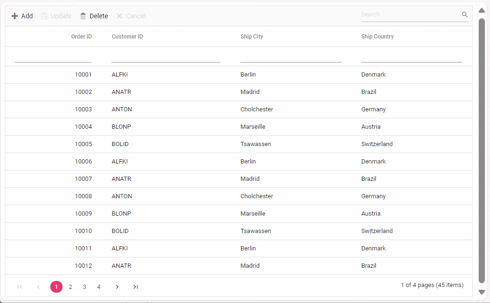

# Binding data from remote service to javascript data grid

## Overview

This repository demonstrates how to bind data from various remote services to a Syncfusion Essential JS 2 (EJ2) [JavaScript Data Grid](https://www.syncfusion.com/javascript-ui-controls/js-data-grid?utm_source=github&utm_medium=listing&utm_campaign=javascript-datagrid-github-samples). It provides examples for integrating data using different adaptors and showcases techniques for handling filtering, sorting, paging, and CRUD operations within JavaScript applications. By exploring this repository, you will learn how to efficiently manage and display data in your applications.

## Features

**[Remote Data Integration](https://ej2.syncfusion.com/react/documentation/grid/data-binding/remote-data?utm_source=github&utm_medium=listing&utm_campaign=javascript-datagrid-github-samples):** Seamlessly bind data from various remote services to the Syncfusion EJ2 JavaScript Grid.

**Data Operations:** Handle [filtering](https://ej2.syncfusion.com/react/documentation/grid/filtering/filtering?utm_source=github&utm_medium=listing&utm_campaign=javascript-datagrid-github-samples), [sorting](https://ej2.syncfusion.com/react/documentation/grid/sorting?utm_source=github&utm_medium=listing&utm_campaign=javascript-datagrid-github-samples), and [paging](https://ej2.syncfusion.com/documentation/grid/paging?utm_source=github&utm_medium=listing&utm_campaign=javascript-datagrid-github-samples) operations with ease.

**[CRUD Operations](https://ej2.syncfusion.com/react/documentation/grid/connecting-to-adaptors/url-adaptor#crud-operations?utm_source=github&utm_medium=listing&utm_campaign=javascript-datagrid-github-samples):** Implement Create, Read, Update, and Delete operations.

**[Adaptors](https://ej2.syncfusion.com/react/documentation/grid/connecting-to-adaptors/url-adaptor?utm_source=github&utm_medium=listing&utm_campaign=javascript-datagrid-github-samples):** Examples of different adaptors to integrate remote data:
* UrlAdaptor
* WebApiAdaptor
* WebMethodAdaptor
* ODataV4Adaptor
* GraphQLAdaptor
* RemoteSaveAdaptor

## Prerequisites

Before you begin, ensure you have met the following requirements:

* Node.js and npm installed

* Basic knowledge of JavaScript and web development

## Getting Started

**1. Clone the Repository:**

Use `git clone` to fetch the repository from GitHub.

```bash
https://github.com/SyncfusionExamples/Binding-data-from-remote-service-to-javascript-data-grid.git 
```

**2. Open and Build the Project:**

* Open the project in Visual Studio.
* Build the project to restore dependencies and compile it.
* Run the project

**3. Explore the Code:**

* Navigate to JavaScript files (typically in wwwroot).
* Debug and interact with the code as needed.



## Resources

You can also refer the below resources to know more details about Syncfusion Javascript Grid components.

* [Demo](https://ej2.syncfusion.com/javascript/demos/?utm_source=github&utm_medium=listing&utm_campaign=javascript-datagrid-github-samples#/bootstrap/grid/grid-overview.html)
* [Documentation](https://ej2.syncfusion.com/javascript/documentation/grid/getting-started?utm_source=github&utm_medium=listing&utm_campaign=javascript-datagrid-github-samples)
* [GraphQL with Syncfusion DataManager](https://ej2.syncfusion.com/javascript/documentation/grid/connecting-to-adaptors/url-adaptor?utm_source=github&utm_medium=listing&utm_campaign=javascript-datagrid-github-samples)